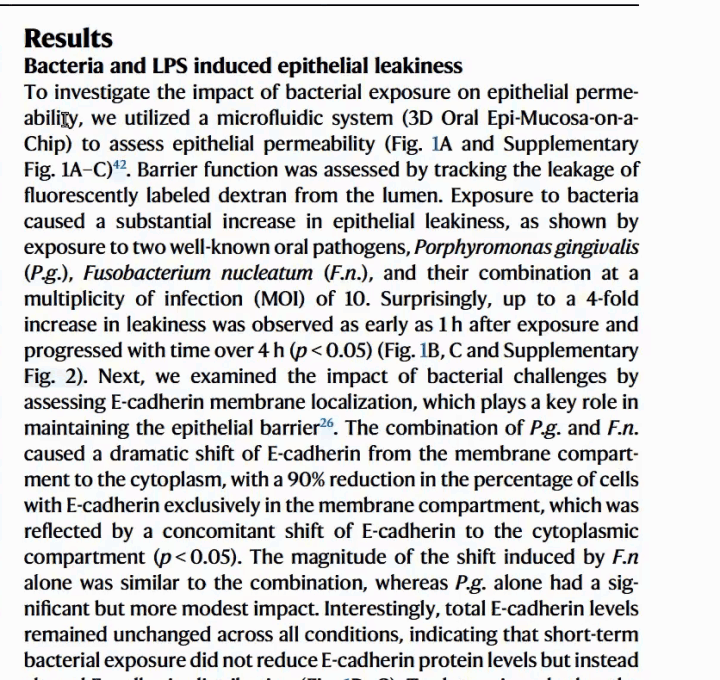
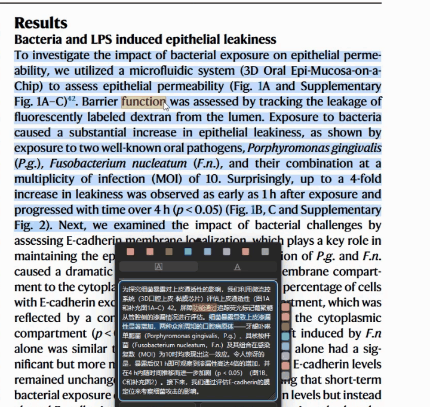

# Sync Translate

[简体中文](README.md) · **English**

Sync Translate connects the text in [Translate for Zotero](https://github.com/windingwind/zotero-pdf-translate) (TFZ) with the source in your PDF. Select a phrase in the translation to highlight its source. Point at a word in the PDF to find it in the translation.

[Project page](https://warmablog.com/projects/sync-translate) · [Download](https://github.com/liuguanlin80-cell/zotero-sync-translate/releases/latest)

Select translated text to highlight the source:



Hold Ctrl and point at a word in the PDF to highlight its translation:



## Requirements

- Zotero 10 (tested with 10.0.7)
- [Translate for Zotero](https://github.com/windingwind/zotero-pdf-translate) (tested with 2.4.8). Install and configure it first; it supplies the translation.
- Word-level alignment with TFZ's current translation service requires an LLM provider: ChatGPT, Custom GPT 1–3, Azure GPT, Claude, or Gemini. Other translation engines give sentence-level alignment only. Testing was limited to an OpenAI-compatible endpoint.

## Install

Download the `.xpi` from [GitHub Releases](https://github.com/liuguanlin80-cell/zotero-sync-translate/releases/latest). In Zotero, open **Tools → Plugins** and drag the file into the Plugins window.

## Use

Select some text in a PDF and let TFZ translate it.

| Action | What happens |
| --- | --- |
| Select text in the translation box | The matching source text is highlighted in the PDF. |
| Click the color swatch next to the translation box | The current source highlight is saved as a Zotero highlight, and the translation box stays open. |
| Point at a word in the PDF | The corresponding text is marked in the translation box. |
| Select a word inside a passage you've already translated | A popup shows the matching translation and its sentence. This behavior has not been fully tested. |
| Click the alignment button in the toolbar | Alignment pauses or resumes. It is enabled again after Zotero restarts. |

A faint highlight marks a whole sentence. A solid highlight with a border marks a matching word or phrase. The first time you align a sentence, Zotero shows the faint highlight and a thin blinking line at the top of the translation box until the model returns a match.

Pointing at a word without Ctrl only uses existing results. Hold Ctrl to request a match if needed. The result stays visible until you release Ctrl.

## Settings

Go to **Edit → Settings → Sync Translate**.

| Setting | Options or behavior |
| --- | --- |
| Word-level alignment | Current translation service (default), off (sentences only), custom OpenAI-compatible endpoint, or Jev |
| Highlight the translation when pointing at a source word | On by default |
| Only while Ctrl is held | Off by default |
| Daily token limit | 0 means unlimited. After reaching the limit, only sentence-level alignment is available. |
| Clear alignment cache / Clear phrase glossary | Deletes the corresponding local data described below. |

## Requests and data

- Selecting part of a sentence or holding Ctrl while pointing at a word can send the source sentence and its translation to the configured model. Selecting a whole sentence or finding a match in the cache or glossary does not send a request.
- By default, word-level alignment reuses the endpoint and API key in your TFZ settings. To avoid reusing them, turn off word-level alignment or choose a custom endpoint.
- The following files stay in the Zotero data directory and are not uploaded:
  - `sync-translate.json`: alignment cache (character offsets only) and a glossary of validated phrase pairs.
  - `sync-translate-log.json`: the last 80 actions, including words you pointed at, for troubleshooting.

## Limitations

- PDF only.
- Text added to a translation that has no matching source cannot be aligned. TFZ's option to include paper context may cause a model to translate more than the selected text, such as the entire abstract.
- When formula rendering is enabled in the TFZ sidebar, Sync Translate cannot match the translated text back to the source.
- Zotero's own color row at the top of the popup closes the translation box when clicked.
- Jev and the custom endpoint setting have not been tested against live services.

## Plugin missing after restarting Zotero?

If Zotero cannot read a plugin file at startup, it can uninstall the plugin. For example, antivirus software might temporarily lock the file during a scan. Reinstall the plugin if this happens. Zotero stores installed plugin files in the `extensions` folder inside your [Zotero profile directory](https://www.zotero.org/support/kb/profile_directory).

## Development

```bash
node build.js              # Generate dist/sync-translate-<version>.xpi and update.json
node test/align.test.js
node test/plugin.test.js
node test/geom.test.js
node test/pdf.test.js
```

Source files live in `src/lib`: `align.js` splits, pairs, and validates text; `provider.js` reads the TFZ configuration and calls the model; `runtime.js` handles Zotero events.

## Acknowledgments

Thanks to the [LINUX DO](https://linux.do/) community for providing a place to share open-source projects and help each other.

## License

MPL-2.0
