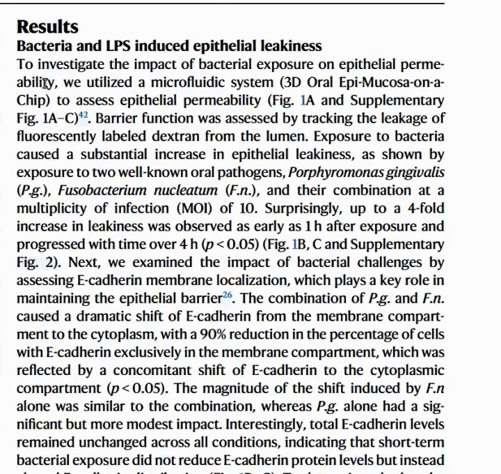
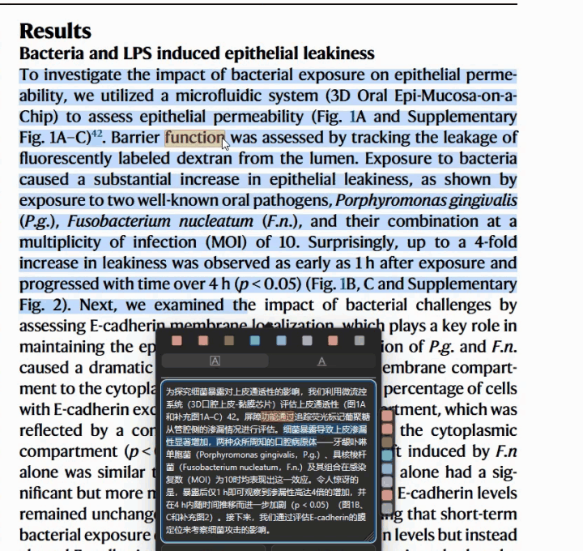

# Sync Translate

Zotero 插件。把 [Translate for Zotero](https://github.com/windingwind/zotero-pdf-translate)（下称 TFZ）的译文和 PDF 原文对应起来：划译文，原文高亮；指原文，译文标出。

[项目介绍](https://warmablog.com/projects/sync-translate) · [下载插件](https://github.com/liuguanlin80-cell/zotero-sync-translate/releases/latest)

划译文，原文高亮：



按住 Ctrl 指原文，译文标出：



## 需要

- Zotero 10（在 10.0.7 上测试）
- Translate for Zotero（在 2.4.8 上测试）
- 词级对齐要求 TFZ 当前的翻译服务是大模型：ChatGPT、自定义 GPT 1–3、Azure GPT、Claude 或 Gemini。其他翻译引擎只能对到整句。只实测过 OpenAI 兼容接口。

## 安装

从 [Releases](../../releases/latest) 下载 `.xpi`，在 Zotero 的“工具 → 插件”里拖入。

## 用法

先在 PDF 里划一段文字，让 TFZ 翻译。

| 操作 | 结果 |
|---|---|
| 在译文框里划选 | PDF 上对应的原文高亮 |
| 点译文框旁的色块 | 把当前高亮的原文存为 Zotero 高亮，翻译窗口保留 |
| 鼠标指向原文单词 | 译文框里标出对应的词 |
| 在已翻译的段落里再划一个词 | 弹窗里显示对应译文和所在句（未充分验证） |
| 点工具栏的“对齐” | 暂停或恢复，重启后恢复为开启 |

高亮有两种：淡色表示只对到整句，带边框的实色表示对到了词或短语。第一次用到某一句时先显示淡色，译文框上沿有一条闪动的细线；模型返回后变为实色。

指向原文时，不按 Ctrl 只使用已有结果；按住 Ctrl 才会为这个词请求模型，结果在松开前保持显示。

## 设置

“编辑 → 设置 → Sync Translate”。

| 项 | 说明 |
|---|---|
| 词级对齐 | 当前翻译服务（默认）/ 关闭，仅整句 / 自定义 OpenAI 兼容接口 / Jev |
| 鼠标指向原文单词时，标出对应译文 | 默认开 |
| 仅在按住 Ctrl 时 | 默认关 |
| 每日 token 上限 | 0 为不限；超过后只对到整句 |
| 清空对齐缓存 / 清空词表 | 删除下面两类本地数据 |

## 请求和数据

- 发出请求的时机：划到某句的一部分，或按住 Ctrl 指向一个词。发送内容是那一句的原文和译文。选中整句、命中缓存或词表时不发请求。
- 默认使用 TFZ 设置里已有的接口地址和密钥；要避免，把“词级对齐”设为关闭或自定义接口。
- 本地文件在 Zotero 数据目录下，不上传：
  - `sync-translate.json`：对齐缓存（只有字符位置）和词表（校验通过的短语对）。
  - `sync-translate-log.json`：最近 80 条操作记录，含指向过的词，用于排查问题。

## 限制

- 只支持 PDF。
- 译文超出所选原文的部分没有对应，划选时提示“所选原文之外”。TFZ 开了“附带论文上下文”时，模型可能把整段摘要都翻出来。
- TFZ 侧栏开启公式渲染时，不能从译文找原文。
- 弹窗顶部那一排颜色是 Zotero 自带的，点它会关闭翻译窗口。
- Jev 和自定义接口两条路线未用真实服务验证。

## 开发

```bash
node build.js              # 生成 dist/sync-translate-<版本>.xpi 和 update.json
node test/align.test.js
node test/plugin.test.js
```

源码在 `src/lib`：`align.js` 分句、配对和校验，`provider.js` 读取 TFZ 配置并请求模型，`runtime.js` 处理 Zotero 里的事件。

## 致谢

感谢 [LINUX DO](https://linux.do/) 社区提供开源项目分享与技术交流的平台，支持开放分享与互助。

## 许可

MPL-2.0
